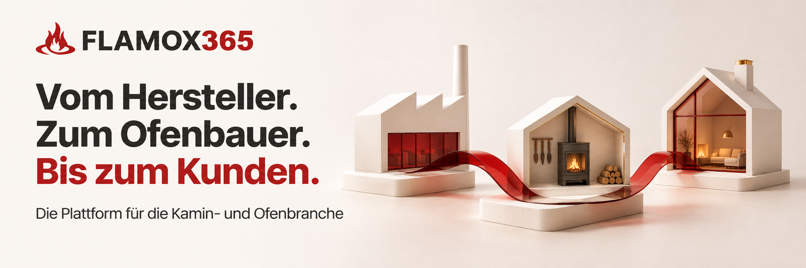

# Die Plattform für die Kamin- und Ofenbranche

**FLAMOX365 verbindet Produktdaten, Verkauf und Handwerk in einem durchgängigen Ablauf.** Vom ersten Kundenkontakt über Beratung, Angebot und Auftrag bis zur Montage, Rechnung und zum Service: Ofenbaubetriebe arbeiten mit einem gemeinsamen Datenstand und behalten ihre Vorgänge im Blick.

Zentral gepflegte Hersteller- und Produktdaten, Zusammenarbeit im Team und ein KI Assistent unterstützen die tägliche Arbeit – im Büro, im Verkauf und unterwegs.

[Webseite](https://www.flamox365.com/) · [Alle Funktionen](https://www.flamox365.com/funktionen/) · [Kontakt](mailto:mail@flamox365.com)

> **In Entwicklung:** FLAMOX365 befindet sich vor dem allgemeinen Marktstart. Portal und Shop sind unten ausdrücklich als Entwicklungszugänge verlinkt.

## Was FLAMOX365 zusammenbringt

- **Kunden und Verkauf:** Interessenten betreuen, Beratungen dokumentieren, Produkte konfigurieren und Angebote bis zur Kundenentscheidung begleiten.
- **Auftrag und Ausführung:** Aufträge, Montage, Rechnungen und Service im Zusammenhang bearbeiten.
- **Produkte und Einkauf:** Hersteller- und Produktdaten im Katalog nutzen und den Einkauf über den Shop für Unternehmen abwickeln.
- **Team und Organisation:** Aufgaben, Termine und Absprachen mit dem jeweiligen Vorgang verbinden.
- **KI Unterstützung:** Informationen erschließen und Arbeitsschritte vorbereiten. Der Assistent schlägt vor, der Mensch entscheidet.
- **Schnittstellen:** Eigene Systeme über API, Webhooks und den Edge Connector anbinden.

## Webseiten und Anwendungen

| Einstieg | Wofür? |
| --- | --- |
| [Webseite](https://www.flamox365.com/) | Produktvorstellung, Zielgruppen und Kontakt |
| [Feature-Katalog](https://www.flamox365.com/funktionen/) | Überblick über Funktionen und ihren Entwicklungsstand |
| [Portal · Entwicklung](https://dev.portal.flamox365.app/) | Arbeitsbereich für Kunden, Verkauf, Aufträge und Team |
| [Shop · Entwicklung](https://dev.flamox365.shop/) | Einkauf für Unternehmen |
| [Status](https://status.flamox365.app/) | Betriebsstatus der Dienste |
| [API und Schnittstelle](https://www.flamox365.com/api-und-schnittstelle/) | Informationen zur Integration eigener Systeme |

## Technologie

| Bereich | Grundlage |
| --- | --- |
| Sprache | TypeScript |
| Oberfläche | Angular und Mosaik |
| Backend | NestJS und Archipel |
| Daten | PostgreSQL und Prisma |
| Schnittstellen | OpenAPI und Webhooks |
| Workspace und Qualität | Nx, Vitest und Playwright |

Mosaik und Archipel stammen aus dem [Pixel-Brewery-Ökosystem](https://github.com/pixel-brewery). FLAMOX365 entwickelt darauf die Fachprozesse für die Kamin- und Ofenbranche.

## Offene Bausteine

Die Fachanwendung wird in einem privaten Repository entwickelt. Öffentlich verfügbar sind:

- [Edge Connector](https://github.com/FLAMOX365/flamox-edge-connector) – lokale Laufzeit und Entwicklungswerkzeuge für die sichere Anbindung betrieblicher Systeme.
- [Edge Connector Extensions](https://github.com/FLAMOX365/flamox-edge-connector-extensions) – Erweiterungskatalog für den Edge Connector.

---

**Aus dem Ofenbau. Für den Ofenbau.** Mehr erfahren auf [flamox365.com](https://www.flamox365.com/).
