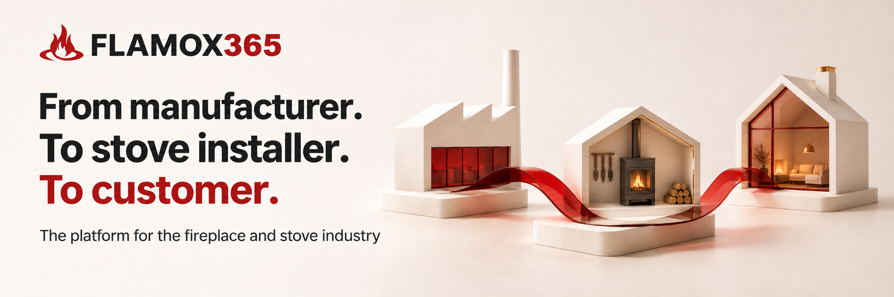

# The platform for the fireplace and stove industry

**FLAMOX365 connects product data, sales and skilled trades in one continuous workflow.** From the first customer enquiry through consultation, quotations and orders to installation, invoicing and service: fireplace and stove businesses work from a shared set of information and keep track of every job.

Centrally maintained manufacturer and product data, team collaboration and an AI assistant support everyday work – in the office, on the sales floor and on site.

[Website](https://www.flamox365.com/) · [Explore all features](https://www.flamox365.com/funktionen/) · [Contact](mailto:mail@flamox365.com)

## What FLAMOX365 brings together

- **Customers and sales:** Manage leads, document consultations, configure products and guide quotations through to the customer's decision.
- **Orders and delivery:** Keep orders, installation, invoices and service connected throughout the job.
- **Products and purchasing:** Work with manufacturer and product data in the catalogue and purchase through the business shop.
- **Team and organisation:** Connect tasks, schedules and conversations to the relevant job.
- **AI assistance:** Find information and prepare next steps. The assistant suggests; people decide.
- **Integrations:** Connect your own systems through the API, webhooks and Edge Connector.

## Explore FLAMOX365

| Destination | What you will find |
| --- | --- |
| [Website](https://www.flamox365.com/) | Product overview, who it is for and contact details |
| [Feature catalogue](https://www.flamox365.com/funktionen/) | Explore the platform's capabilities |
| [Portal for stove installers](https://www.flamox365.com/ofenbauer/) | Customers, sales, orders and teamwork |
| [Business shop](https://www.flamox365.com/shop/) | Purchasing for businesses |
| [Service status](https://status.flamox365.app/) | Operational status of the services |
| [API and integrations](https://www.flamox365.com/api-und-schnittstelle/) | Information on connecting your own systems |

## Technology

| Area | Foundation |
| --- | --- |
| Language | TypeScript |
| Frontend | Angular and Mosaik |
| Backend | NestJS and Archipel |
| Data | PostgreSQL and Prisma |
| Interfaces | OpenAPI and webhooks |
| Workspace and quality | Nx, Vitest and Playwright |

Mosaik and Archipel are part of the [Pixel Brewery ecosystem](https://github.com/pixel-brewery). FLAMOX365 builds on these foundations to support the workflows of the fireplace and stove industry.

## Public building blocks

- [Edge Connector](https://github.com/FLAMOX365/flamox-edge-connector) – a local runtime and development tools for securely connecting business systems.
- [Edge Connector Extensions](https://github.com/FLAMOX365/flamox-edge-connector-extensions) – the extension catalogue for Edge Connector.

---

**From the trade. For the trade.** Learn more at [flamox365.com](https://www.flamox365.com/).
